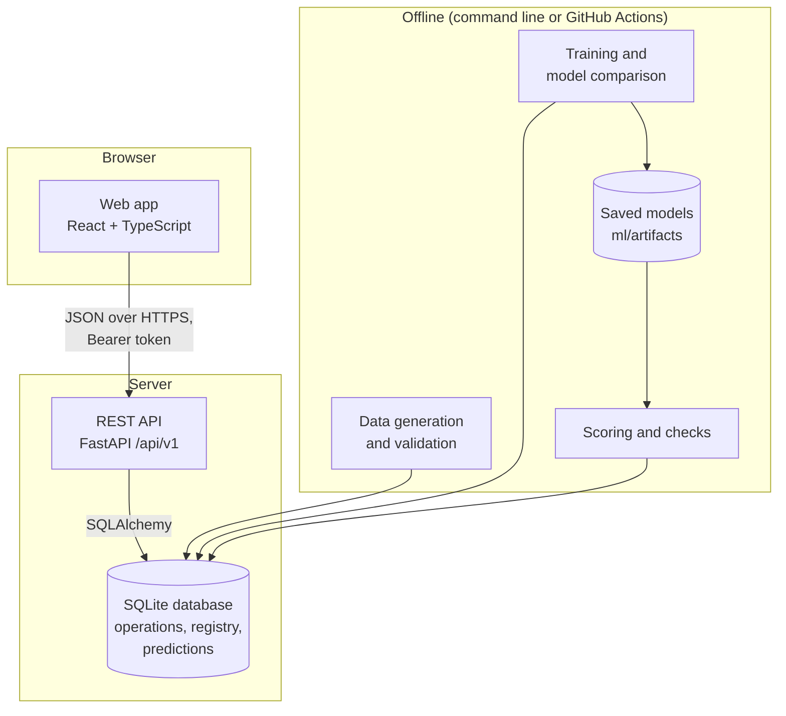
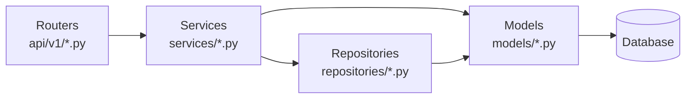

# Architecture

The platform has four parts: a web app, a REST API, one relational database, and an
offline machine-learning pipeline. GitHub Actions tests, checks and packages all of them.

The API never runs a neural network itself: the selected models write their
predictions into tables offline, and the API reads them like any other data. That keeps
TensorFlow out of the web server and every page fast.

## Backend (`backend/app/`)

A request passes through clear layers; each only calls the one below it.

| Layer | Folder | Responsibility |
|---|---|---|
| Routers | `api/v1/` | HTTP: paths, input and output schemas, who may call (role dependencies in `api/v1/access.py`, `core/permissions.py`) |
| Schemas | `schemas/` | Pydantic models: validate input (limits, formats) and shape output |
| Services | `services/` | business rules and transactions: stock never negative, order status rules, approvals, reservations, alerts, audit, dashboards, ML results |
| Repositories | `repositories/` | list and search queries (filters, paging, sorting) |
| Models | `models/` | SQLAlchemy tables with their constraints; schema changes only through Alembic migrations (`migrations/`) |
| Core | `core/` | settings from `.env`, logging, password hashing and tokens, failed-login limit, security headers |
| Errors | `exceptions/` | business errors become clean JSON answers (404, 409, 422); unexpected errors a 500 with a reference |

Examples of rules kept in the services:

- **Stock** (`inventory_service`): every change writes an immutable movement; capacity
  of the bin (weight, volume) is checked; staff losses and transfers between warehouses
  wait for a manager (`approval_service`).
- **Orders** (`order_service`, `allocation_service`, `fulfillment_service`,
  `shipment_service`, `return_service`): a fixed status lifecycle; confirming reserves
  stock (what is missing waits as a backorder and is filled when stock arrives);
  allocation creates the picking tasks as a walking route (farthest racks first, so the
  picker ends at packing); packing, shipping, tracking and returns update stock and
  status together.
- **Alerts** (`alert_service`): low stock and over-full bins are raised and resolved
  automatically after every stock change; late parcels and overdue purchase orders when
  they are checked (a delayed tracking event, or the check buttons on the Shipments and
  Purchase orders pages).
- **Audit** (`audit_tracking`): every change to business data is logged with the user
  and the old and new values.

## Web app (`frontend/src/`)

React 19 with TypeScript, built with Vite and styled with Tailwind CSS.

| Folder | Contents |
|---|---|
| `pages/` | one page per menu item (dashboard, products, inventory, orders, fulfillment, ML insights...) |
| `components/` | shared building blocks (tables, forms, charts, badges) and the parts of each page |
| `api/` | one module per area that calls the API; the Axios client adds the token and renews it automatically |
| `context/`, `hooks/` | the logged-in user (`AuthProvider`), toasts, data loading with TanStack Query |
| `routes/` | the page routes and `ProtectedRoute`, which sends visitors to login and wrong roles to "Access denied" |

Forms are validated with React Hook Form and Zod before they reach the API, which
validates again. The access token lives only in memory; the refresh token is an
`httpOnly` cookie the page's scripts cannot read.

## Machine learning (`ml/`)

| Folder | Contents |
|---|---|
| `data_generation/` | the two-year warehouse simulation (master data, orders, fulfillment, shipping, returns, purchasing) |
| `data_validation/` | checks of the generated dataset (integrity, volume, business patterns) |
| `feature_engineering/` | the features of each use case, built only from the past |
| `baselines/`, `models/` | the simple baselines and the Keras networks of each use case |
| `training/`, `evaluation/`, `registry/` | training runs, metrics and reports, model registry and selection |
| `inference/` | scoring with the selected models, and the checks of models and predictions |

See [ml.md](ml.md) for the six use cases and their results.

## Data

One SQLite database holds the operational data, the model registry and the predictions.
See [database.md](database.md) for the design rules and every table.

## Quality and delivery

| Workflow | What it does |
|---|---|
| Backend CI | Ruff (with security rules), Black, tests with at least 96 % coverage, migrations, API smoke test |
| Frontend CI | ESLint, Prettier, TypeScript, tests with coverage minimums, production build |
| ML CI | lint, tests, small dataset, quick training, scoring, model and prediction checks, backtest |
| Security | dependency audits (pip-audit, npm audit) on changes and every Monday |
| Train models | full training run, started by hand; reports and models as downloads |
| Delivery | builds and smoke-tests the release package; on a version tag runs all tests and publishes the GitHub Release |

Security and speed are documented in [security.md](security.md) and
[performance.md](performance.md).

## Limits of this design

- **SQLite** suits one server and a moderate number of users; it is fast enough for the
  full dataset (see performance.md). Many users at once would call for PostgreSQL; the
  code uses SQLAlchemy and Alembic, but a few queries use SQLite date functions.
- **Failed-login counters** are kept in the API's memory, which is right for one process.
- **Predictions** are as fresh as the last scoring run, which is started by hand or by a
  scheduled job.
