# Database

The platform stores everything in one relational database: SQLite (a single file,
`database/warehouse.db` by default, set by `DATABASE_URL`). The schema is created and
changed only through **Alembic migrations** (`backend/migrations/`, `alembic upgrade
head`); a test fails if a model changes without a migration.

## Design rules

- **Stock is never edited, only moved.** `inventory` holds the current quantities per
  product and bin (on hand, reserved, damaged); every change also writes one immutable
  row to `inventory_movements` with the quantities after it, who made it and why
  (receipt, pick, transfer, adjustment, return...). The history always adds up to the
  current stock.
- **Exact numbers.** Money, weights and sizes are stored as whole numbers of their
  smallest unit (cents, grams, millimetres) and read back as exact decimals, never as
  floating point.
- **UTC times.** Timestamps are stored in UTC and returned with their offset.
- **Rules in the database too.** Check constraints keep quantities, statuses and ranges
  valid (for example reserved units never exceed units on hand), and foreign keys are
  enforced (`PRAGMA foreign_keys=ON`).
- **Audit.** Changes to business data are written to `audit_logs` with the old and new
  values and who made them.
- **Predictions are added, not replaced.** Each scoring run of the ML models adds rows
  with its `scored_at` and `as_of`; the application shows the latest run.
- **Indexes** follow the queries: lists sorted newest first and date filters
  (see [performance.md](performance.md)).

## Tables

Generated from the models (`backend/app/models/`); the backend tests fail when this
reference is out of date.

<!-- generated:schema:start (scripts/generate_docs.py) -->

43 tables in 11 areas. Each diagram shows the tables of an area and the tables they refer to; `||--o{` reads "one ... has many".

### Users and security

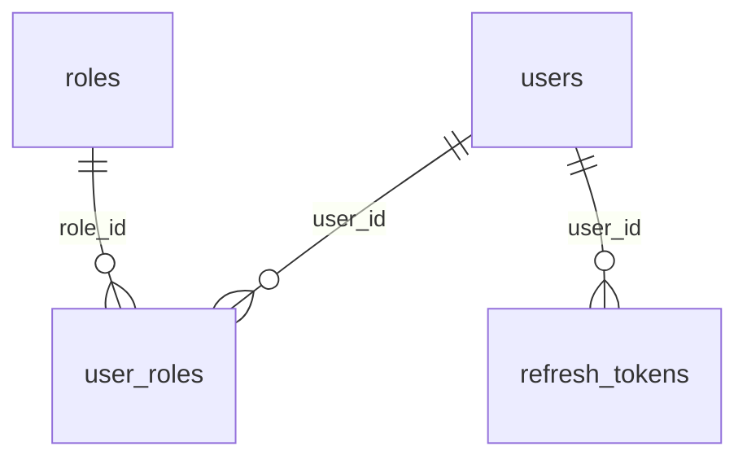

#### `user_roles`

Which user has which role.

| Column | Type | Required | Notes |
|---|---|---|---|
| `user_id` | integer | yes | primary key, → `users.id` |
| `role_id` | integer | yes | primary key, → `roles.id` |
| `assigned_at` | object | yes |  |

#### `roles`

A named permission group, e.g. `admin`.

| Column | Type | Required | Notes |
|---|---|---|---|
| `id` | integer | yes | primary key |
| `name` | text | yes | unique |
| `description` | text |  |  |

#### `users`

A person who can log in to the platform.

| Column | Type | Required | Notes |
|---|---|---|---|
| `id` | integer | yes | primary key |
| `email` | text | yes | unique |
| `full_name` | text | yes |  |
| `hashed_password` | text | yes |  |
| `is_active` | bool | yes |  |
| `last_login_at` | object |  |  |
| `created_at` | object | yes |  |
| `updated_at` | object | yes |  |

#### `refresh_tokens`

A long-lived refresh token. Only a SHA-256 hash of the token is stored.

| Column | Type | Required | Notes |
|---|---|---|---|
| `id` | integer | yes | primary key |
| `user_id` | integer | yes | → `users.id` |
| `token_hash` | text | yes | unique |
| `created_at` | object | yes |  |
| `expires_at` | object | yes |  |
| `revoked_at` | object |  |  |
| `user_agent` | text |  |  |
| `ip_address` | text |  |  |

### Catalog and suppliers

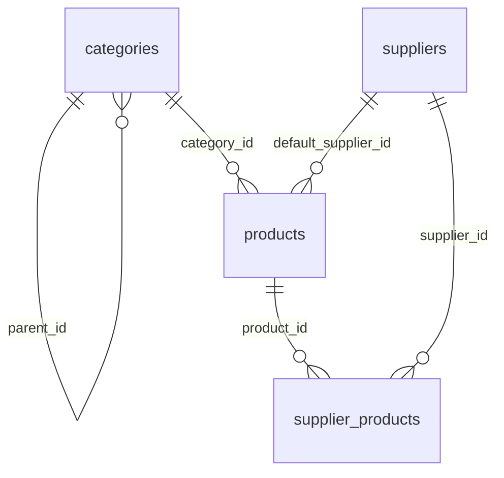

#### `categories`

A product category. Categories can be nested (e.g. Electronics > Laptops).

| Column | Type | Required | Notes |
|---|---|---|---|
| `id` | integer | yes | primary key |
| `name` | text | yes | unique |
| `description` | text |  |  |
| `parent_id` | integer |  | → `categories.id` |
| `is_active` | bool | yes |  |
| `created_at` | object | yes |  |
| `updated_at` | object | yes |  |

#### `suppliers`

A company that supplies products to the warehouse.

| Column | Type | Required | Notes |
|---|---|---|---|
| `id` | integer | yes | primary key |
| `code` | text | yes | unique |
| `name` | text | yes |  |
| `contact_name` | text |  |  |
| `email` | text |  |  |
| `phone` | text |  |  |
| `address` | text |  |  |
| `country` | text |  |  |
| `lead_time_days` | integer | yes |  |
| `reliability_score` | object | yes |  |
| `is_active` | bool | yes |  |
| `created_at` | object | yes |  |
| `updated_at` | object | yes |  |

#### `products`

A stock-keeping unit (SKU) that can be stored, ordered and shipped.

| Column | Type | Required | Notes |
|---|---|---|---|
| `id` | integer | yes | primary key |
| `sku` | text | yes | unique |
| `name` | text | yes |  |
| `description` | text |  |  |
| `category_id` | integer | yes | → `categories.id` |
| `brand` | text |  |  |
| `unit_price` | object | yes |  |
| `unit_cost` | object | yes |  |
| `weight_kg` | object | yes |  |
| `length_cm` | object | yes |  |
| `width_cm` | object | yes |  |
| `height_cm` | object | yes |  |
| `barcode` | text |  | unique |
| `min_stock` | integer | yes |  |
| `max_stock` | integer |  |  |
| `default_supplier_id` | integer |  | → `suppliers.id` |
| `is_active` | bool | yes |  |
| `created_at` | object | yes |  |
| `updated_at` | object | yes |  |

#### `supplier_products`

A product as offered by one supplier (their SKU, price, lead time, order size).

| Column | Type | Required | Notes |
|---|---|---|---|
| `id` | integer | yes | primary key |
| `supplier_id` | integer | yes | → `suppliers.id` |
| `product_id` | integer | yes | → `products.id` |
| `supplier_sku` | text |  |  |
| `unit_cost` | object | yes |  |
| `lead_time_days` | integer |  |  |
| `min_order_qty` | integer | yes |  |
| `is_preferred` | bool | yes |  |
| `created_at` | object | yes |  |
| `updated_at` | object | yes |  |

### Warehouse layout

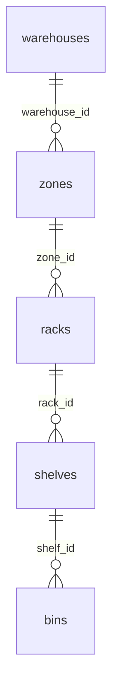

#### `warehouses`

A warehouse site, the top of the location hierarchy.

| Column | Type | Required | Notes |
|---|---|---|---|
| `id` | integer | yes | primary key |
| `code` | text | yes | unique |
| `name` | text | yes |  |
| `address` | text |  |  |
| `is_active` | bool | yes |  |
| `created_at` | object | yes |  |
| `updated_at` | object | yes |  |

#### `zones`

An area of a warehouse with one purpose (e.g. picking, bulk, returns).

| Column | Type | Required | Notes |
|---|---|---|---|
| `id` | integer | yes | primary key |
| `warehouse_id` | integer | yes | → `warehouses.id` |
| `code` | text | yes |  |
| `name` | text | yes |  |
| `zone_type` | text | yes |  |
| `is_active` | bool | yes |  |
| `created_at` | object | yes |  |
| `updated_at` | object | yes |  |

#### `racks`

A rack in a zone, with its walking distance to the packing area.

| Column | Type | Required | Notes |
|---|---|---|---|
| `id` | integer | yes | primary key |
| `zone_id` | integer | yes | → `zones.id` |
| `code` | text | yes |  |
| `distance_to_packing_m` | object | yes |  |
| `is_active` | bool | yes |  |
| `created_at` | object | yes |  |
| `updated_at` | object | yes |  |

#### `shelves`

A level of a rack (level 1 is the floor).

| Column | Type | Required | Notes |
|---|---|---|---|
| `id` | integer | yes | primary key |
| `rack_id` | integer | yes | → `racks.id` |
| `code` | text | yes |  |
| `level` | integer | yes |  |
| `is_active` | bool | yes |  |
| `created_at` | object | yes |  |
| `updated_at` | object | yes |  |

#### `bins`

The smallest storage location. Stock (Phase 4) is always held in a bin.

| Column | Type | Required | Notes |
|---|---|---|---|
| `id` | integer | yes | primary key |
| `shelf_id` | integer | yes | → `shelves.id` |
| `code` | text | yes |  |
| `location_code` | text | yes | unique |
| `max_weight_kg` | object | yes |  |
| `max_volume_cm3` | integer | yes |  |
| `is_active` | bool | yes |  |
| `created_at` | object | yes |  |
| `updated_at` | object | yes |  |

### Inventory

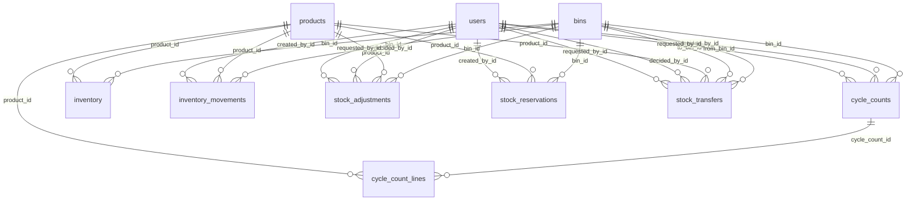

#### `inventory`

Current stock of one product in one bin.

| Column | Type | Required | Notes |
|---|---|---|---|
| `id` | integer | yes | primary key |
| `product_id` | integer | yes | → `products.id` |
| `bin_id` | integer | yes | → `bins.id` |
| `quantity_on_hand` | integer | yes |  |
| `quantity_reserved` | integer | yes |  |
| `quantity_damaged` | integer | yes |  |
| `version` | integer | yes |  |
| `created_at` | object | yes |  |
| `updated_at` | object | yes |  |

#### `inventory_movements`

One immutable change of stock in one bin (the audit trail of every unit).

| Column | Type | Required | Notes |
|---|---|---|---|
| `id` | integer | yes | primary key |
| `movement_type` | text | yes |  |
| `product_id` | integer | yes | → `products.id` |
| `bin_id` | integer | yes | → `bins.id` |
| `quantity` | integer | yes |  |
| `on_hand_delta` | integer | yes |  |
| `reserved_delta` | integer | yes |  |
| `damaged_delta` | integer | yes |  |
| `on_hand_after` | integer | yes |  |
| `reserved_after` | integer | yes |  |
| `damaged_after` | integer | yes |  |
| `reference_type` | text |  |  |
| `reference_id` | integer |  |  |
| `reason` | text |  |  |
| `created_by_id` | integer |  | → `users.id` |
| `created_at` | object | yes |  |

#### `stock_transfers`

Moving units of one product from one bin to another.

| Column | Type | Required | Notes |
|---|---|---|---|
| `id` | integer | yes | primary key |
| `product_id` | integer | yes | → `products.id` |
| `from_bin_id` | integer | yes | → `bins.id` |
| `to_bin_id` | integer | yes | → `bins.id` |
| `quantity` | integer | yes |  |
| `status` | text | yes |  |
| `reason` | text |  |  |
| `created_at` | object | yes |  |
| `updated_at` | object | yes |  |
| `requested_by_id` | integer |  | → `users.id` |
| `decided_by_id` | integer |  | → `users.id` |
| `decided_at` | object |  |  |
| `decision_note` | text |  |  |

#### `stock_adjustments`

A correction of stock in one bin (found, lost, damaged, restored, written off).

| Column | Type | Required | Notes |
|---|---|---|---|
| `id` | integer | yes | primary key |
| `product_id` | integer | yes | → `products.id` |
| `bin_id` | integer | yes | → `bins.id` |
| `kind` | text | yes |  |
| `quantity` | integer | yes |  |
| `status` | text | yes |  |
| `reason` | text | yes |  |
| `created_at` | object | yes |  |
| `updated_at` | object | yes |  |
| `requested_by_id` | integer |  | → `users.id` |
| `decided_by_id` | integer |  | → `users.id` |
| `decided_at` | object |  |  |
| `decision_note` | text |  |  |

#### `stock_reservations`

Units of a product in a bin held for an order (Phase 5) or by a manager.

| Column | Type | Required | Notes |
|---|---|---|---|
| `id` | integer | yes | primary key |
| `product_id` | integer | yes | → `products.id` |
| `bin_id` | integer | yes | → `bins.id` |
| `quantity` | integer | yes |  |
| `status` | text | yes |  |
| `reference_type` | text |  |  |
| `reference_id` | integer |  |  |
| `reason` | text |  |  |
| `created_by_id` | integer |  | → `users.id` |
| `closed_at` | object |  |  |
| `created_at` | object | yes |  |
| `updated_at` | object | yes |  |

#### `cycle_counts`

A physical count of one bin, compared with what the system expects.

| Column | Type | Required | Notes |
|---|---|---|---|
| `id` | integer | yes | primary key |
| `bin_id` | integer | yes | → `bins.id` |
| `status` | text | yes |  |
| `note` | text |  |  |
| `submitted_at` | object |  |  |
| `created_at` | object | yes |  |
| `updated_at` | object | yes |  |
| `requested_by_id` | integer |  | → `users.id` |
| `decided_by_id` | integer |  | → `users.id` |
| `decided_at` | object |  |  |
| `decision_note` | text |  |  |

#### `cycle_count_lines`

Expected vs counted quantity of one product in the counted bin.

| Column | Type | Required | Notes |
|---|---|---|---|
| `id` | integer | yes | primary key |
| `cycle_count_id` | integer | yes | → `cycle_counts.id` |
| `product_id` | integer | yes | → `products.id` |
| `expected_quantity` | integer | yes |  |
| `counted_quantity` | integer |  |  |

### Orders, returns and customers

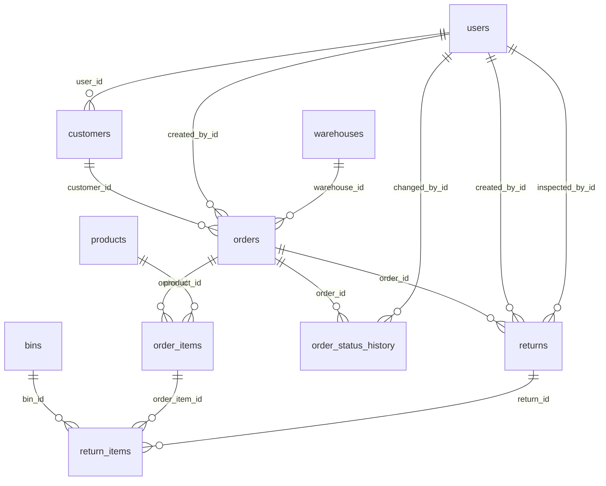

#### `customers`

Someone who orders. May be linked to a login with the customer role (self-service); business customers without a login are ordered for by managers.

| Column | Type | Required | Notes |
|---|---|---|---|
| `id` | integer | yes | primary key |
| `code` | text | yes | unique |
| `name` | text | yes |  |
| `customer_type` | text | yes |  |
| `email` | text |  |  |
| `phone` | text |  |  |
| `address_line` | text |  |  |
| `postal_code` | text |  |  |
| `city` | text |  |  |
| `country` | text |  |  |
| `user_id` | integer |  | → `users.id`, unique |
| `is_active` | bool | yes |  |
| `created_at` | object | yes |  |
| `updated_at` | object | yes |  |

#### `orders`

A customer order: its lines, status, delivery address and milestones.

| Column | Type | Required | Notes |
|---|---|---|---|
| `id` | integer | yes | primary key |
| `order_number` | text | yes | unique |
| `customer_id` | integer | yes | → `customers.id` |
| `warehouse_id` | integer |  | → `warehouses.id` |
| `status` | text | yes |  |
| `priority` | text | yes |  |
| `requested_delivery_date` | date |  |  |
| `ship_to_name` | text | yes |  |
| `ship_to_address` | text |  |  |
| `ship_to_postal_code` | text |  |  |
| `ship_to_city` | text |  |  |
| `ship_to_country` | text |  |  |
| `notes` | text |  |  |
| `subtotal` | object | yes |  |
| `created_by_id` | integer |  | → `users.id` |
| `confirmed_at` | object |  |  |
| `shipped_at` | object |  |  |
| `delivered_at` | object |  |  |
| `cancelled_at` | object |  |  |
| `cancel_reason` | text |  |  |
| `status_before_hold` | text |  |  |
| `created_at` | object | yes |  |
| `updated_at` | object | yes |  |

#### `order_items`

One line of an order and how far it has come through fulfillment.

| Column | Type | Required | Notes |
|---|---|---|---|
| `id` | integer | yes | primary key |
| `order_id` | integer | yes | → `orders.id` |
| `line_number` | integer | yes |  |
| `product_id` | integer | yes | → `products.id` |
| `quantity` | integer | yes |  |
| `unit_price` | object | yes |  |
| `quantity_reserved` | integer | yes |  |
| `quantity_picked` | integer | yes |  |
| `quantity_packed` | integer | yes |  |
| `quantity_shipped` | integer | yes |  |
| `quantity_returned` | integer | yes |  |

#### `order_status_history`

One status change of an order: from, to, who, when and why.

| Column | Type | Required | Notes |
|---|---|---|---|
| `id` | integer | yes | primary key |
| `order_id` | integer | yes | → `orders.id` |
| `from_status` | text |  |  |
| `to_status` | text | yes |  |
| `note` | text |  |  |
| `changed_by_id` | integer |  | → `users.id` |
| `created_at` | object | yes |  |

#### `returns`

A customer return of (some of) the shipped units of an order.

| Column | Type | Required | Notes |
|---|---|---|---|
| `id` | integer | yes | primary key |
| `return_number` | text | yes | unique |
| `order_id` | integer | yes | → `orders.id` |
| `status` | text | yes |  |
| `reason` | text | yes |  |
| `created_by_id` | integer |  | → `users.id` |
| `inspected_by_id` | integer |  | → `users.id` |
| `completed_at` | object |  |  |
| `created_at` | object | yes |  |
| `updated_at` | object | yes |  |

#### `return_items`

Units of one order line in a return, their condition and where they went.

| Column | Type | Required | Notes |
|---|---|---|---|
| `id` | integer | yes | primary key |
| `return_id` | integer | yes | → `returns.id` |
| `order_item_id` | integer | yes | → `order_items.id` |
| `quantity` | integer | yes |  |
| `condition` | text |  |  |
| `bin_id` | integer |  | → `bins.id` |
| `note` | text |  |  |

### Picking and packing

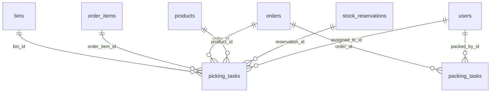

#### `picking_tasks`

Picking one order line from one bin: where to go, what to take, what was found.

| Column | Type | Required | Notes |
|---|---|---|---|
| `id` | integer | yes | primary key |
| `order_id` | integer | yes | → `orders.id` |
| `order_item_id` | integer | yes | → `order_items.id` |
| `reservation_id` | integer | yes | → `stock_reservations.id`, unique |
| `product_id` | integer | yes | → `products.id` |
| `bin_id` | integer | yes | → `bins.id` |
| `quantity` | integer | yes |  |
| `quantity_picked` | integer |  |  |
| `sequence` | integer | yes |  |
| `status` | text | yes |  |
| `assigned_to_id` | integer |  | → `users.id` |
| `started_at` | object |  |  |
| `completed_at` | object |  |  |
| `short_reason` | text |  |  |
| `created_at` | object | yes |  |
| `updated_at` | object | yes |  |

#### `packing_tasks`

Packing one picked order: check the items, then record parcels and weight.

| Column | Type | Required | Notes |
|---|---|---|---|
| `id` | integer | yes | primary key |
| `order_id` | integer | yes | → `orders.id`, unique |
| `status` | text | yes |  |
| `packed_by_id` | integer |  | → `users.id` |
| `started_at` | object |  |  |
| `completed_at` | object |  |  |
| `package_count` | integer |  |  |
| `weight_kg` | object |  |  |
| `note` | text |  |  |
| `created_at` | object | yes |  |
| `updated_at` | object | yes |  |

### Shipping

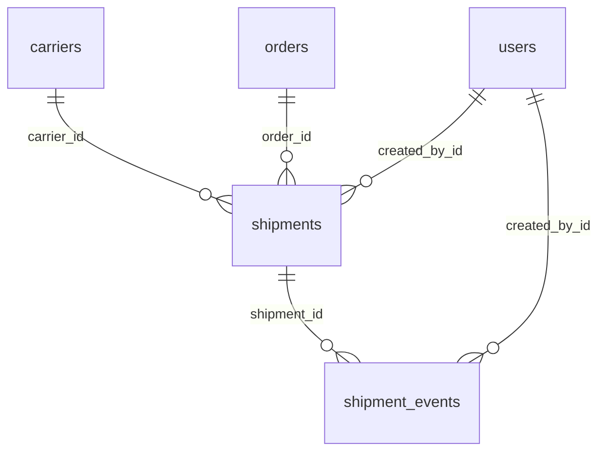

#### `carriers`

A parcel carrier (e.g. DHL) with its tracking link and usual transit time.

| Column | Type | Required | Notes |
|---|---|---|---|
| `id` | integer | yes | primary key |
| `code` | text | yes | unique |
| `name` | text | yes |  |
| `tracking_url_template` | text |  |  |
| `default_transit_days` | integer | yes |  |
| `is_active` | bool | yes |  |
| `created_at` | object | yes |  |
| `updated_at` | object | yes |  |

#### `shipments`

The parcel(s) of a packed order handed to a carrier, with its tracking.

| Column | Type | Required | Notes |
|---|---|---|---|
| `id` | integer | yes | primary key |
| `order_id` | integer | yes | → `orders.id`, unique |
| `carrier_id` | integer | yes | → `carriers.id` |
| `tracking_number` | text | yes |  |
| `status` | text | yes |  |
| `package_count` | integer | yes |  |
| `weight_kg` | object | yes |  |
| `shipped_at` | object | yes |  |
| `expected_delivery_date` | date | yes |  |
| `delivered_at` | object |  |  |
| `created_by_id` | integer |  | → `users.id` |
| `created_at` | object | yes |  |
| `updated_at` | object | yes |  |

#### `shipment_events`

One step of a shipment's journey (the tracking timeline).

| Column | Type | Required | Notes |
|---|---|---|---|
| `id` | integer | yes | primary key |
| `shipment_id` | integer | yes | → `shipments.id` |
| `event_type` | text | yes |  |
| `occurred_at` | object | yes |  |
| `location` | text |  |  |
| `description` | text |  |  |
| `created_by_id` | integer |  | → `users.id` |
| `created_at` | object | yes |  |

### Purchasing

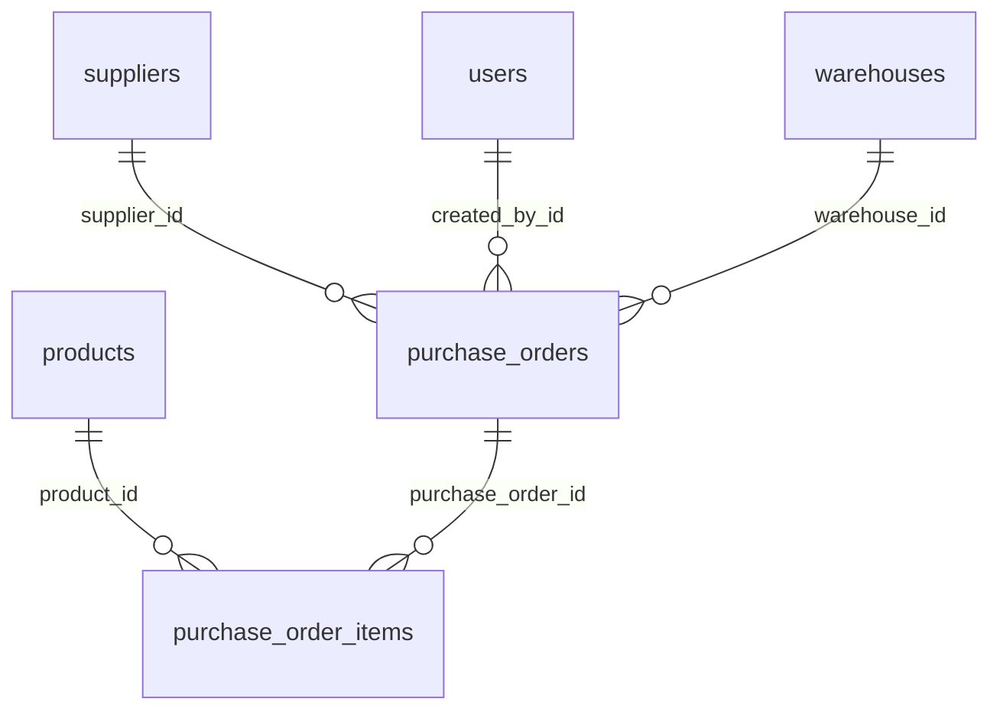

#### `purchase_orders`

An order of stock from a supplier for one warehouse (draft, ordered, received).

| Column | Type | Required | Notes |
|---|---|---|---|
| `id` | integer | yes | primary key |
| `po_number` | text | yes | unique |
| `supplier_id` | integer | yes | → `suppliers.id` |
| `warehouse_id` | integer | yes | → `warehouses.id` |
| `status` | text | yes |  |
| `expected_date` | date | yes |  |
| `notes` | text |  |  |
| `created_by_id` | integer |  | → `users.id` |
| `ordered_at` | object |  |  |
| `received_at` | object |  |  |
| `created_at` | object | yes |  |
| `updated_at` | object | yes |  |

#### `purchase_order_items`

One product line of a purchase order: quantity, cost and how much arrived.

| Column | Type | Required | Notes |
|---|---|---|---|
| `id` | integer | yes | primary key |
| `purchase_order_id` | integer | yes | → `purchase_orders.id` |
| `product_id` | integer | yes | → `products.id` |
| `quantity` | integer | yes |  |
| `unit_cost` | object | yes |  |
| `quantity_received` | integer | yes |  |

### Alerts and audit

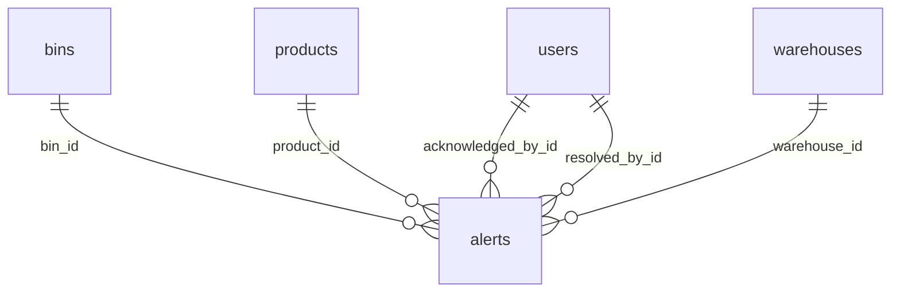

#### `audit_logs`

Who changed what and when, with the old and new values (append-only).

| Column | Type | Required | Notes |
|---|---|---|---|
| `id` | integer | yes | primary key |
| `created_at` | object | yes |  |
| `actor_id` | integer |  |  |
| `actor_email` | text |  |  |
| `action` | text | yes |  |
| `entity_type` | text | yes |  |
| `entity_id` | integer |  |  |
| `summary` | text |  |  |
| `changes` | object |  |  |

#### `alerts`

A problem that needs attention, e.g. "LAP-001 is below its minimum stock".

| Column | Type | Required | Notes |
|---|---|---|---|
| `id` | integer | yes | primary key |
| `alert_type` | text | yes |  |
| `severity` | text | yes |  |
| `status` | text | yes |  |
| `dedup_key` | text | yes |  |
| `title` | text | yes |  |
| `message` | text |  |  |
| `product_id` | integer |  | → `products.id` |
| `bin_id` | integer |  | → `bins.id` |
| `warehouse_id` | integer |  | → `warehouses.id` |
| `acknowledged_by_id` | integer |  | → `users.id` |
| `acknowledged_at` | object |  |  |
| `resolved_by_id` | integer |  | → `users.id` |
| `resolved_at` | object |  |  |
| `created_at` | object | yes |  |
| `updated_at` | object | yes |  |

### ML model registry

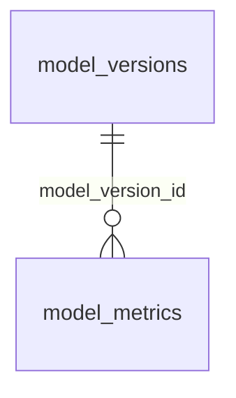

#### `model_versions`

A trained model (or baseline) of a use case, with its data, settings and status.

| Column | Type | Required | Notes |
|---|---|---|---|
| `id` | integer | yes | primary key |
| `use_case` | text | yes |  |
| `model_name` | text | yes |  |
| `version` | text | yes |  |
| `is_baseline` | bool | yes |  |
| `status` | text | yes |  |
| `dataset_version` | text | yes |  |
| `features` | object | yes |  |
| `hyperparameters` | object | yes |  |
| `artifact_path` | text |  |  |
| `trained_at` | object | yes |  |
| `train_seconds` | number |  |  |
| `notes` | text |  |  |
| `created_at` | object | yes |  |
| `updated_at` | object | yes |  |

#### `model_metrics`

One evaluation number of a model on a split (train, validation or test).

| Column | Type | Required | Notes |
|---|---|---|---|
| `id` | integer | yes | primary key |
| `model_version_id` | integer | yes | → `model_versions.id` |
| `split` | text | yes |  |
| `name` | text | yes |  |
| `value` | number | yes |  |

### ML predictions

```mermaid
erDiagram
    bins ||--o{ slotting_recommendations : "current_bin_id"
    bins ||--o{ slotting_recommendations : "recommended_bin_id"
    model_versions ||--o{ delay_predictions : "model_version_id"
    model_versions ||--o{ demand_forecasts : "model_version_id"
    model_versions ||--o{ movement_classifications : "model_version_id"
    model_versions ||--o{ product_recommendations : "model_version_id"
    model_versions ||--o{ reorder_recommendations : "model_version_id"
    model_versions ||--o{ slotting_recommendations : "model_version_id"
    orders ||--o{ delay_predictions : "order_id"
    products ||--o{ demand_forecasts : "product_id"
    products ||--o{ movement_classifications : "product_id"
    products ||--o{ product_recommendations : "product_id"
    products ||--o{ product_recommendations : "recommended_product_id"
    products ||--o{ reorder_recommendations : "product_id"
    products ||--o{ slotting_recommendations : "product_id"
    purchase_orders ||--o{ reorder_recommendations : "purchase_order_id"
    shipments ||--o{ delay_predictions : "shipment_id"
    users ||--o{ reorder_recommendations : "decided_by_id"
    users ||--o{ slotting_recommendations : "decided_by_id"
    warehouses ||--o{ reorder_recommendations : "warehouse_id"
    warehouses ||--o{ slotting_recommendations : "warehouse_id"
```

#### `demand_forecasts`

Expected units of a product on one forecast day, with an 80 % range.

| Column | Type | Required | Notes |
|---|---|---|---|
| `id` | integer | yes | primary key |
| `product_id` | integer | yes | → `products.id` |
| `day` | date | yes |  |
| `expected_units` | number | yes |  |
| `low_units` | number | yes |  |
| `high_units` | number | yes |  |
| `model_version_id` | integer | yes | → `model_versions.id` |
| `scored_at` | object | yes |  |
| `as_of` | date | yes |  |

#### `reorder_recommendations`

Stockout risk of a product in a warehouse and what to order.

| Column | Type | Required | Notes |
|---|---|---|---|
| `id` | integer | yes | primary key |
| `product_id` | integer | yes | → `products.id` |
| `warehouse_id` | integer | yes | → `warehouses.id` |
| `probability` | number | yes |  |
| `priority` | text | yes |  |
| `reorder_date` | date | yes |  |
| `quantity` | integer | yes |  |
| `reasons` | object | yes |  |
| `purchase_order_id` | integer |  | → `purchase_orders.id` |
| `status` | text | yes |  |
| `decided_by_id` | integer |  | → `users.id` |
| `decided_at` | object |  |  |
| `decision_note` | text |  |  |
| `model_version_id` | integer | yes | → `model_versions.id` |
| `scored_at` | object | yes |  |
| `as_of` | date | yes |  |

#### `movement_classifications`

Fast, medium or slow mover.

| Column | Type | Required | Notes |
|---|---|---|---|
| `id` | integer | yes | primary key |
| `product_id` | integer | yes | → `products.id` |
| `movement_class` | text | yes |  |
| `picks_per_day` | number | yes |  |
| `model_version_id` | integer | yes | → `model_versions.id` |
| `scored_at` | object | yes |  |
| `as_of` | date | yes |  |

#### `slotting_recommendations`

A better pick-face bin for a product in a warehouse.

| Column | Type | Required | Notes |
|---|---|---|---|
| `id` | integer | yes | primary key |
| `product_id` | integer | yes | → `products.id` |
| `warehouse_id` | integer | yes | → `warehouses.id` |
| `current_bin_id` | integer |  | → `bins.id` |
| `recommended_bin_id` | integer | yes | → `bins.id` |
| `current_seconds_per_day` | number |  |  |
| `recommended_seconds_per_day` | number | yes |  |
| `status` | text | yes |  |
| `decided_by_id` | integer |  | → `users.id` |
| `decided_at` | object |  |  |
| `decision_note` | text |  |  |
| `model_version_id` | integer | yes | → `model_versions.id` |
| `scored_at` | object | yes |  |
| `as_of` | date | yes |  |

#### `delay_predictions`

Risk that a shipment on its way arrives late, with the main reasons.

| Column | Type | Required | Notes |
|---|---|---|---|
| `id` | integer | yes | primary key |
| `order_id` | integer | yes | → `orders.id` |
| `shipment_id` | integer | yes | → `shipments.id` |
| `probability` | number | yes |  |
| `risk_level` | text | yes |  |
| `reasons` | object | yes |  |
| `model_version_id` | integer | yes | → `model_versions.id` |
| `scored_at` | object | yes |  |
| `as_of` | date | yes |  |

#### `product_recommendations`

A product often added to a basket that holds `product_id` (rank 1 = best).

| Column | Type | Required | Notes |
|---|---|---|---|
| `id` | integer | yes | primary key |
| `product_id` | integer | yes | → `products.id` |
| `recommended_product_id` | integer | yes | → `products.id` |
| `rank` | integer | yes |  |
| `score` | number | yes |  |
| `model_version_id` | integer | yes | → `model_versions.id` |
| `scored_at` | object | yes |  |
| `as_of` | date | yes |  |

<!-- generated:schema:end -->
