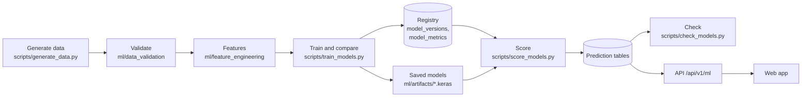

# Machine learning

Six use cases help the warehouse decide. Every one compares simple **baselines** with
**TensorFlow/Keras** networks on data no model saw while training, and a network is used
only when it beats the best baseline. All numbers below are from the full generated
dataset (2 years, 499,179 orders, 2,000 products).

## The pipeline

| Step | Command (from the project root) | Result |
|---|---|---|
| Generate | `python scripts/generate_data.py --size full` | a validated two-year dataset (`--size small` / `medium` for quick runs) |
| Train | `python scripts/train_models.py` | every model of every use case trained, compared and registered; reports in `ml/evaluation/reports/` |
| Score | `python scripts/score_models.py` | predictions of the selected models stored in the prediction tables |
| Check | `python scripts/check_models.py` | the selected models load; the predictions are complete and valid |
| Backtest | `python scripts/score_models.py --backtest 30` | predictions as of 30 days earlier, compared with what happened |

On GitHub, the *Train models* workflow (Actions tab) runs the same steps and keeps the
reports and models as downloads.

## How models are compared

- **Chronological split**: train on the first 580 days, tune on the next 60
  (validation: early stopping, decision thresholds), test on the last 90. Features only
  use what was known at the time, so no future information leaks in.
- **Same questions for everyone**: baselines and networks answer exactly the same
  test questions and are scored with the same metric.
- **Selection**: the network with the best test score is selected only if it is strictly
  better than the best baseline; otherwise the baseline is selected. Every model is
  registered with its dataset, features, settings and metrics, selected or not.
- **Reproducible**: fixed seeds; settings in `ml/configs/*.yaml`.

## The six use cases

### 1. Demand forecasting

- **Question**: how many units of each product will customers order on each of the next
  30 days, and in what range?
- **Data**: daily ordered units per product (cancelled orders included: the wish to buy
  happened); the last 56 days, promotions, weekday and season; category and typical level.
- **Baselines**: moving average, seasonal naive. **Networks**: LSTM, GRU, CNN-LSTM,
  Transformer, each predicting a low, expected and high value (80 % range).
- **Selected**: **LSTM**. Error of the 7/14/30-day totals 35.1 % vs 41.2 % for the
  moving average; 86 % of days inside the 80 % range.
- **In the app**: product page (30-day chart with range, totals); dashboard (demand of
  the next 7 and 30 days, latest forecast error).
- **Checked against reality**: forecast made 30 days before the end of the data: 26 %
  error on each product's 30-day total (25 % in testing), all products together 4.2 %
  too low, 86 % of product-days inside the range.

### 2. Reorder recommendation

- **Question**: will a product run out in a warehouse within 14 days, and what and when
  to order?
- **Data**: the stock history rebuilt day by day from the movements (available, on
  order, days of cover), demand over 7/28/56 days, last year's season, supplier lead
  time and reliability; for the LSTM the last weeks of demand and stock.
- **Baseline**: reorder-point formula. **Networks**: Dense, Wide & Deep, LSTM.
- **Selected**: **LSTM**. Stockout PR-AUC 0.328 vs 0.166; it catches 52 % of stockouts
  while flagging 20 % of products (formula: 49 % while flagging 31 %).
- **Output**: probability, priority, order-by date, quantity (enough for the lead time,
  a safety buffer and the following weeks) and the main reasons.
- **In the app**: ML insights → Reorder; approving drafts a purchase order with the
  product's supplier (at least the supplier's minimum order quantity).

### 3. Movement classification

- **Question**: is a product a fast, medium or slow mover?
- **Data**: per product: picks and units per day, share of selling days, irregularity,
  trend, order size, days between sales.
- **Baseline**: ABC analysis. **Networks**: Autoencoder + K-Means, VAE + K-Means, Deep
  Embedded Clustering.
- **Selected**: **ABC** (baseline). No learned grouping was both stable across seeds and
  useful; ABC's fast class carries 79 % of next-period picks.
- **In the app**: product page; ML insights → Movement; used by slotting.

### 4. Slotting

- **Question**: which bin should each product be picked from?
- **Data**: products, bins, pick frequency, current location, and an estimated pick time
  (walking distance, handling, heavy goods high up, step ladders).
- **Baseline**: ABC slotting. **Networks**: Dense and Wide & Deep suitability networks,
  followed by an optimizer that keeps every zone, weight and volume rule.
- **Selected**: **Dense suitability**. 49.8 % less estimated picking time than the
  current layout (ABC 49.7 %, perfect foresight 50.1 %), no rule broken.
- **In the app**: ML insights → Slotting (approve or reject each move).

### 5. Order-delay prediction

- **Question**: will a parcel arrive after its expected delivery date?
- **Data** (at dispatch): order size and value, waiting for stock, time to dispatch,
  carrier and its recent late rate, how full the warehouse was, season; for the LSTM
  the order's status events up to dispatch.
- **Baseline**: logistic regression. **Networks**: Dense, Wide & Deep, Deep & Cross,
  LSTM on order events.
- **Selected**: **LSTM on events**. PR-AUC 0.119 vs 0.116. The simulator's own delay
  formula reaches only 0.114 on this period: delays are mostly chance in this data.
- **In the app**: order page (risk and reasons while on its way); ML insights → Delay
  risk; dashboard (high-risk deliveries).
- **Checked against reality**: 24 % of medium-risk and 16 % of low-risk parcels arrived
  late: the ranking points the right way, but the model is weak, so the dashboard counts
  only high-risk parcels.

### 6. Product recommendation

- **Question**: which products does a customer add to a basket that holds this one?
- **Data**: baskets (the other products), the customer, their earlier orders.
- **Baseline**: frequently bought together. **Networks**: NCF, Two-Tower, Deep & Cross,
  GRU.
- **Selected**: **frequently bought together** (baseline). The held-out product is in
  the top 10 for 56 % of baskets (best network: Two-Tower, 46 %).
- **In the app**: product page (also for customers).

## What the results say

The networks win clearly where the data has structure the simple rules ignore (seasonal
demand, stockouts before peaks). Where the simple rule already matches how the data
arises (baskets built from product pairs, classes defined by pick rate) or the outcome
is mostly chance (delays), the baseline is as good or better, and the selection keeps
it. Two notes: TensorFlow Recommenders needs the older Keras 2, so the Two-Tower model
is written in plain Keras 3; the slotting pick time is an estimate, and the cost of
moving stock into a new layout is not counted.

## Predictions in the application

Predictions are made **offline** by `scripts/score_models.py`, not by the API: the
backend only reads the prediction tables (`demand_forecasts`, `reorder_recommendations`,
`movement_classifications`, `slotting_recommendations`, `delay_predictions`,
`product_recommendations`), so it needs no TensorFlow and stays fast. Each run adds rows
with its `scored_at` and `as_of`; the application shows the run with the latest
`as_of`, so a backtest never replaces the current predictions. Decisions on reorder and
slotting recommendations are recorded on the rows and in the audit log.

The detailed comparison of every model is in `ml/evaluation/reports/` (one report per
use case and `overview.md`).
